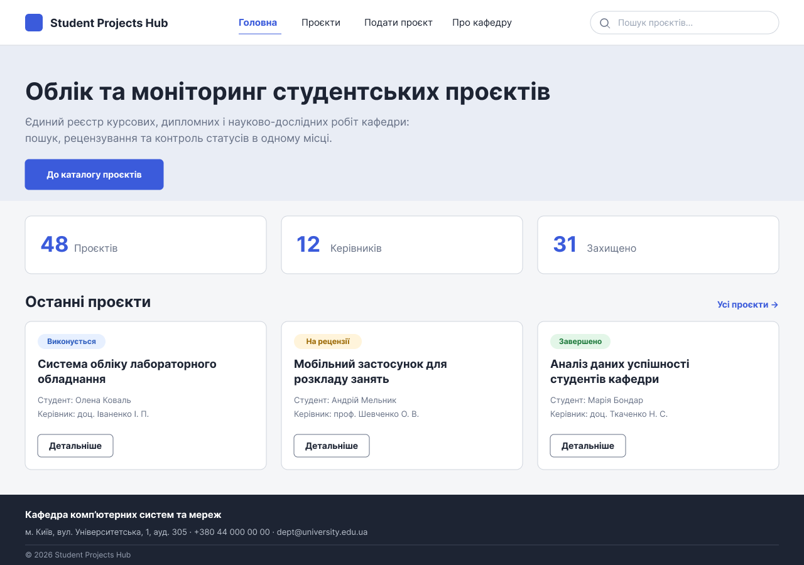
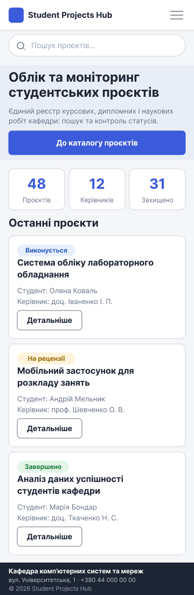

# Звіт з лабораторної роботи № 1
**Дисципліна:** «WEB-програмування»  
**Тема:** Визначення власного об’єкта дослідження (наскрізна задача). Структура веб-проєкту та організація репозиторію GitHub  
**Варіант:** 12 — Облік студентських проєктів (*Student Projects Hub*)  
**Виконала:** Вероніка Селезньова, група KI-24  
**Посилання на репозиторій:** https://github.com/Arthas263/stud-project-hub

---

## 1. Мета роботи та індивідуальне завдання
**Мета роботи:** обрати предметну область наскрізного проєкту, сформулювати вимоги до нього, спроєктувати структуру веб-застосунку, створити макети сторінок та організувати репозиторій GitHub для поетапної розробки проєкту протягом семестру.

**Індивідуальне завдання (варіант 12):**
1. Обрати тему наскрізного проєкту згідно з варіантом 12 — «Облік студентських проєктів» (основні сутності: teacher, project, student, review).
2. Скласти документ вимог обсягом не менше однієї сторінки з описом сутностей, атрибутів та зв’язків.
3. Розробити два адаптивні макети (desktop 1280 px і mobile 360 px) головної сторінки.
4. Створити та оформити публічний репозиторій GitHub зі структурою каталогів, README.md і .gitignore.
5. Продемонструвати роботу з гілками: гілка lab01, три змістовні коміти та злиття з main через Pull Request.

---

## 2. Постановка задачі та предметна область
Об’єктом розробки є веб-застосунок **Student Projects Hub** для автоматизації обліку, моніторингу та рецензування студентських курсових і дипломних проєктів на кафедрі.

### Основні сутності та зв’язки:
* **Teacher** (*Викладач*) — науковий керівник або рецензент (id, full_name, department, academic_degree, email).
* **Student** (*Студент*) — виконавець проєкту (id, full_name, group_name, email, phone).
* **Project** (*Проєкт*) — навчальна чи дипломна робота (id, title, description, teacher_id, student_id, status, repo_url, created_at).
* **Review** (*Рецензія*) — відгук та оцінка викладача (id, project_id, teacher_id, comment, grade, created_at).

Реалізовано зв’язки типу **«один до багатьох» (1 — ∞)**: один викладач керує багатьма проєктами та залишає багато рецензій; один студент може виконувати кілька проєктів; один проєкт може отримати декілька рецензій. Повний документ вимог оформлено у файлі [docs/requirements.md](../../docs/requirements.md).

---

## 3. Структура репозиторію та історія комітів
У корені репозиторію організовано таку файлову структуру:

* **docs/** — проєктна документація та макети:
  * mockups/home-desktop.png — макет головної сторінки (1280 px);
  * mockups/home-mobile.png — макет головної сторінки (360 px);
  * requirements.md — технічні вимоги та модель БД;
* **labs/lab01/report.md** — звіт з виконання лабораторної роботи № 1;
* **src/** — вихідний код клієнтської частини (assets/img/, css/, js/, pages/, index.html);
* **.gitignore** — перелік виключень для системи контролю версій Git;
* **README.md** — опис проєкту та навігація по репозиторію.

### Підтвердження роботи з гілкою lab01 та комітами:
* Гілка розробки: lab01 (злита у main через Pull Request)
* Коміт 1 (70c9195): lab01: add project structure and requirements document
* Коміт 2 (8f078a8): lab01: add desktop and mobile mockups of the home page
* Коміт 3 (49094fa): lab01: add lab report

---

## 4. Адаптивні макети інтерфейсу
Для головної сторінки (/) розроблено два каркасних макети з урахуванням вимог адаптивності від 360 px:

### 4.1. Десктопна версія (1280 px)
На широких екранах навігаційне меню та поле пошуку розміщено в один рядок у шапці сайту, а картки останніх проєктів згруповані у сітку з трьох колонок.

### 4.2. Мобільна версія (360 px)
На мобільних пристроях навігація згортається у кнопку бургер-меню, поле пошуку виноситься на окремий рядок, а картки проєктів перебудовуються в одну колонку для зручного перегляду без горизонтальної прокрутки.

---

## 5. Відповіді на контрольні запитання

**1. Що таке наскрізна задача та які переваги дає такий спосіб організації практикуму?**  
Наскрізна задача — це єдиний цілісний веб-проєкт, який обирається на початку семестру та послідовно розвивається протягом усіх шістнадцяти лабораторних робіт. Перевага такого підходу полягає в тому, що студент бачить повний життєвий цикл створення реального застосунку: кожна нова тема не виконується на відірваному синтетичному прикладі, а додає новий технологічний шар (розмітку, стилі, клієнтську логіку, сервер, базу даних, тестування) до власного проєкту.

**2. Які вимоги висуваються до предметної області проєкту?**  
Предметна область має містити щонайменше три сутності, дві з яких пов’язані відношенням «один до багатьох» (1 — ∞); застосунок повинен мати щонайменше чотири розділи (головна сторінка, перелік записів, картка окремого запису, форма введення з валідацією); дані мають зберігатися у реляційній базі даних, а інтерфейс повинен бути адаптивним від ширини екрана 360 px.

**3. Назвіть три області Git та поясніть призначення кожної.**  
* Робоча копія (Working Directory) — каталог на диску комп’ютера, де розробник створює, редагує або видаляє поточні файли проєкту.  
* Індекс (Staging Area) — проміжна буферна область, у якій формується набір змін, підготовлених для включення до наступного коміту.  
* Локальний репозиторій (.git) — прихована база даних проєкту на комп’ютері розробника, де зберігається вся історія зафіксованих комітів, гілок і тегів.

**4. Чим відрізняються команди git add, git commit, git push і git pull?**  
* git add переносить зміни з робочої копії до області індексу (Staging Area).  
* git commit фіксує підготовлені в індексі зміни у вигляді нового знімка (коміту) в локальному репозиторії.  
* git push відправляє локальні коміти та гілки на віддалений сервер (GitHub).  
* git pull завантажує нові зміни з віддаленого репозиторію та одразу об’єднує їх із поточною локальною гілкою.

**5. Що таке гілка та для чого створюється окрема гілка на кожну лабораторну роботу?**  
Гілка (branch) — це рухомий вказівник на певну послідовність комітів. Створення окремої гілки (наприклад, lab01) ізолює розробку поточної лабораторної роботи від стабільної основної гілки main, дозволяючи безпечно тестувати зміни, вести чисту історію та зручно перевіряти виконану роботу через Pull Request.

**6. Що таке Pull Request і які можливості він надає під час перевірки коду?**  
Pull Request (PR) — це запит на злиття змін з однієї гілки в іншу на платформі GitHub. Під час перевірки коду PR надає зручний візуальний перегляд усіх змінених рядків (diff), історію комітів, можливість залишати коментарі до конкретних рядків коду, обговорювати правки та запускати автоматичні перевірки перед фінальним злиттям у main.

**7. Для чого призначений файл .gitignore і які шляхи до нього включають?**  
Файл .gitignore вказує Git, які службові файли та каталоги не потрібно відстежувати та завантажувати у репозиторій. Зазвичай туди включають каталоги залежностей (node_modules/), збірки (dist/, build/), файли з конфіденційними ключами та налаштуваннями (.env), системні файли (.DS_Store, Thumbs.db), журнали (*.log) та конфігурації середовищ розробки (.vscode/, .idea/).

**8. Які розділи має містити файл README.md навчального проєкту?**  
Файл README.md має містити назву та короткий опис призначення проєкту, відомості про автора (ПІБ, група, номер варіанта), стек технологій, опис структури каталогів репозиторію, інструкцію із запуску та таблицю ходу виконання лабораторних робіт із посиланнями на відповідні гілки та статусами.

**9. Чому Git не відстежує порожні каталоги та як це обійти?**  
Git відстежує не самі папки, а вміст файлів та їхні шляхи, тому порожній каталог без файлів не може бути доданий до індексу та зафіксований у коміті. Щоб зберегти структуру порожніх директорій у репозиторії, у них створюють порожній прихований файл-заглушку (зазвичай .gitkeep).

**10. Опишіть типову структуру каталогів клієнтської частини веб-проєкту.**  
У корені клієнтської частини (src/) розміщується головна сторінка index.html та підкаталоги за типом ресурсів: pages/ (внутрішні HTML-сторінки: каталог, картка, форма), css/ (таблиці стилів), js/ (клієнтські сценарії та логіка взаємодії з API) та assets/img/ (зображення, іконки та медіафайли).

---

## 6. Висновки
Під час виконання лабораторної роботи № 1 було обрано тему наскрізного проєкту «Облік студентських проєктів» (варіант 12), сформовано технічні вимоги у файлі docs/requirements.md та розроблено адаптивні каркасні макети головної сторінки для десктопної (1280 px) і мобільної (360 px) версій. Організовано публічний репозиторій на GitHub зі структурою каталогів, файлами README.md і .gitignore, виконано три змістовні коміти у гілці lab01 та злито її з гілкою main через Pull Request.