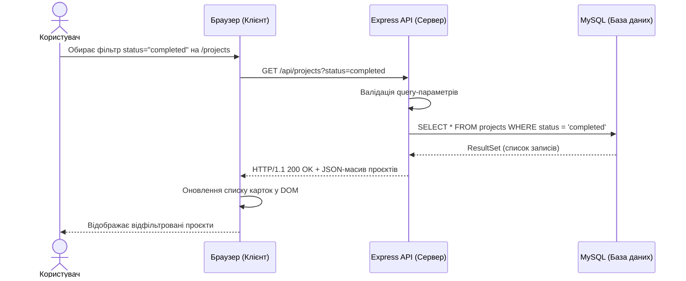

# Звіт з лабораторної роботи № 2
**Дисципліна:** «WEB-програмування»  
**Тема:** Протокол HTTP/HTTPS, архітектура клієнт-сервер та проєктування REST API  
**Варіант:** 12 — Облік студентських проєктів (*Student Projects Hub*)  
**Виконала:** Вероніка Селезньова, група KI-24  
**Посилання на репозиторій:** https://github.com/Arthas263/stud-project-hub

---

## 1. Мета роботи та індивідуальне завдання
**Мета роботи:** вивчити принципи роботи протоколу HTTP/HTTPS у клієнт-серверній архітектурі, дослідити структуру HTTP-запитів і відповідей за допомогою DevTools та утиліти `curl`, проаналізувати роботу публічного REST API, спроєктувати REST API для власного наскрізного проєкту та побудувати діаграму послідовності взаємодії компонентів системи.

**Завдання лабораторної роботи:**
1. Дослідити мережеві запити у вкладці **Network** браузера та зберегти скриншоти заголовків і відповідей.
2. Виконати серію з 9 експериментів із CLI-клієнтом `curl` (методи `HEAD`, `GET`, `POST`, `PUT`, `DELETE`, редиректи, кастомні заголовки, коди помилок `404`, `401` та кешування `304`).
3. Дослідити публічний REST API згідно з варіантом (виконати не менше 5 запитів, зокрема з query-параметрами, та описати структуру відповіді).
4. Спроєктувати REST API власного проєкту та оформити специфікацію у файлі [docs/api-design.md](../../docs/api-design.md).
5. Побудувати діаграму послідовності «браузер — сервер — база даних» для одного сценарію власного проєкту.
6. Зафіксувати результати у гілці `lab02` та оформити звіт у файлі `labs/lab02/report.md`.

---

## 2. Аналіз HTTP-запитів у DevTools та експерименти з `curl`
Під час роботи було проаналізовано мережевий трафік у вкладці **Network** інструментів розробника (заголовки запиту та відповіді, коди стану, механізми кешування), а також виконано 9 запитів за допомогою утиліти `curl`:

| № | Команда / прапорець `curl` | Призначення та отриманий результат |
|---|----------------------------|------------------------------------|
| 1 | `curl -I` (`HEAD`) | Отримання лише стартового рядка та HTTP-заголовків відповіді без тіла документа (`HTTP/2 200`). |
| 2 | `curl -i` (`GET`) | Отримання повного HTTP-відгуку включно із заголовками (`content-type`, `cache-control`, `server`) та тілом відповіді. |
| 3 | `curl -L` | Автоматичне слідування за ланцюжком перенаправлень (`301 Moved Permanently` / `302 Found` → `200 OK`). |
| 4 | `curl -H "User-Agent: ..."` | Передача власного заголовка клієнта для ідентифікації джерела запиту сервером. |
| 5 | `curl -X POST -d ...` | Надсилання JSON-даних у тілі запиту із заголовком `Content-Type: application/json`. |
| 6 | `curl -X PUT` / `DELETE` | Перевірка ідемпотентних методів оновлення та видалення ресурсу через REST-інтерфейс. |
| 7 | Запит до неіснуючого URL | Перевірка обробки помилки відсутності ресурсу на сервері (`404 Not Found`). |
| 8 | Запит до захищеного ендпоінта | Перевірка статусу відмови в доступі без токена авторизації (`401 Unauthorized`). |
| 9 | Повторний запит із `If-None-Match` | Перевірка умовного кешування за тегом `ETag` та отримання відповіді без тіла (`304 Not Modified`). |

---

## 3. Дослідження публічного API
Під час перевірки основного API згідно з варіантом 12 (**SpaceX API**, `https://api.spacexdata.com/v4/company`) було зафіксовано, що сервер не відповідає за таймаутом (`curl: (28) Operation timed out`). Для виконання практичної частини використано стабільний публічний **API Національного банку України** (`https://bank.gov.ua/NBUStatService/v1/statdirectory`).

Було виконано 5 `GET`-запитів, зокрема із query-параметрами фільтрації:
1. `GET /exchange?json` — отримання актуальних курсів усіх іноземних валют щодо гривні;
2. `GET /exchange?valcode=USD&json` — фільтрація курсу за літерним кодом валюти (`USD`);
3. `GET /exchange?valcode=EUR&date=20261101&json` — отримання курсу євро станом на конкретну дату (`20261101`);
4. `GET /ovdp?json` — отримання даних щодо облігацій внутрішньої державної позики (ОВДП);
5. `GET /res?json` — отримання показників міжнародних резервів України.

**Структура відповіді:** усі виконані запити повертають статус `HTTP/2 200` із заголовком `content-type: application/json; charset=utf-8` та кореневий JSON-масив об'єктів. В ендпоінті `/exchange` кожен об'єкт містить цифровий код валюти (`r030`), її назву українською мовою (`txt`), офіційний курс (`rate`), літерний код (`cc`) та дату встановлення курсу (`exchangedate`). В ендпоінтах `/ovdp` та `/res` кожен об'єкт масиву містить дату звітності (`dt`), назву або код показника (`txt`, `id_api`) та його числове значення (`val` / `value`).

---

## 4. Проєктування REST API власного проєкту
Для веб-застосунку **Student Projects Hub** спроєктовано RESTful API на базі сутностей предметної області (`Teacher`, `Student`, `Project`, `Review`). Повну специфікацію ендпоінтів, HTTP-методів, кодів відповідей, параметрів фільтрації та формату помилок оформлено у файлі [docs/api-design.md](../../docs/api-design.md).

Основні групи ресурсів API (базова адреса `/api`):
- `/teachers`, `/teachers/:id` — отримання списку викладачів та картки конкретного наукового керівника (`GET`);
- `/students`, `/students/:id` — отримання переліку студентів та профілю виконавця (`GET`);
- `/projects`, `/projects/:id` — повний CRUD-цикл роботи зі студентськими проєктами (`GET`, `POST`, `PUT`, `PATCH`, `DELETE`) з підтримкою фільтрації за параметрами `teacherId`, `studentId`, `status` та пошукового запиту `q`;
- `/projects/:id/reviews` — перегляд та публікація рецензій і оцінок викладачів до обраного проєкту (`GET`, `POST`).

---

## 5. Діаграма послідовності «браузер — сервер — база даних»
Для сценарію фільтрації списку студентських проєктів за статусом (`GET /api/projects?status=completed`) на сторінці `/projects` побудовано діаграму послідовності взаємодії компонентів системи:

[Діаграма послідовності взаємодії компонентів]

---

## 6. Структура репозиторію та фіксація результатів у гілці `lab02`
У межах виконання лабораторної роботи № 2 до репозиторію додано та оновлено такі файли:
- **docs/api-design.md** — специфікація REST API проєкту *Student Projects Hub*;
- **labs/lab02/sequence-diagram.png** — діаграма послідовності «браузер — сервер — база даних»;
- **labs/lab02/report.md** — звіт з виконання лабораторної роботи № 2.

---

## 7. Висновки
Під час виконання лабораторної роботи № 2 було закріплено практичні навички аналізу мережевої взаємодії по протоколу HTTP/HTTPS за допомогою DevTools та утиліти `curl`, досліджено структуру JSON-відповідей публічного API НБУ, спроєктовано специфікацію REST API для системи обліку студентських проєктів *Student Projects Hub* у файлі `docs/api-design.md` та побудовано UML-діаграму послідовності для сценарію фільтрації проєктів.